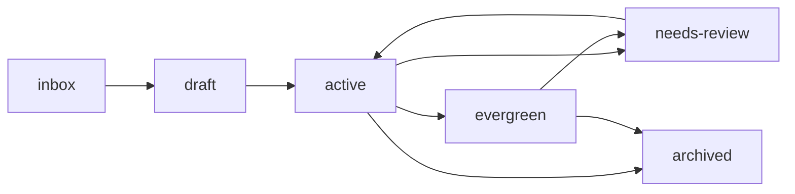

# Knowledge Base Standards & Guidelines (`CONTRIBUTING.md`)

This document defines the architectural standards, information taxonomy, metadata schemas, naming rules, and operational hygiene for maintaining `kbase`.

---

## 1. Information Taxonomy

Every note in `kbase` belongs to a defined taxonomy categorized by **directory structure**, **note type**, and **lifecycle status**.

### 1.1 Root Taxonomy Directories

| Directory | Focus & Contents |
| :--- | :--- |
| `inbox/` | Transient, uncategorized capture zone (<30-second mobile notes). Notes should not remain here permanently. |
| `knowledge/` | Evergreen concepts, domain references, architectural notes, and study material. Reusable and long-lived. |
| `procedures/` | Actionable, step-by-step Standard Operating Procedures (SOPs), troubleshooting records, and checklists. |
| `projects/` | Context-bound documentation, project roadmaps, architecture decision records, and active task tracking. |
| `resources/` | External reading lists, literature reviews, book takeaways, and documentation indexes. |
| `attachments/` | Static diagrams and screenshots (sanitized, compressed, no secrets). |
| `archive/` | Historical, superseded, or completed notes preserved for reference. |
| `tools/` | Standalone, lightweight maintenance and validation scripts. |

### 1.2 Note Types (`type`)

Use the `type` field in frontmatter to classify the conceptual format of the document:

- `concept`: Explanation of a theoretical or architectural concept (e.g., *How Linux Virtual Memory Works*).
- `reference`: Compact cheatsheet, syntax reference, or command lookup table.
- `procedure`: Step-by-step operational SOP designed to be executed linearly.
- `troubleshooting`: Structured diagnostic record covering symptoms, root cause, fix, and verification.
- `lab`: Hands-on technical or cybersecurity lab write-up with defined scope and findings.
- `study-note`: Academic or exam preparation material focused on concepts, definitions, and review questions.
- `project`: Project overview, milestones, and implementation tracking.
- `resource`: Curated summary of an external book, research paper, whitepaper, or article.
- `decision`: Architecture or Technical Decision Record (ADR) detailing options and trade-offs.
- `capture`: Raw, unformatted note captured quickly from mobile or terminal.

### 1.3 Lifecycle Statuses (`status`)

Notes progress through explicit lifecycle states:



- `inbox`: Raw note pending review and categorization.
- `draft`: Work-in-progress note actively being drafted.
- `active`: Functioning note under current usage or development.
- `evergreen`: Thoroughly vetted, authoritative, and stable long-term reference.
- `needs-review`: Requires verification due to software version changes, stale links, or outdated procedures.
- `archived`: Superseded, decommissioned, or completed material preserved for history.

---

## 2. Frontmatter Metadata Schema

Notes use an optional, lightweight YAML frontmatter block at the top of the file. The schema is intentionally simple, human-readable, and does not require a database or special plugin.

### 2.1 Standard Schema

```yaml
---
title: Descriptive Title of the Note
type: concept
area: systems
topics:
  - linux
  - memory
status: active
created: 2026-10-12
updated: 2026-10-12
source: "https://example.com/reference"
---
```

### 2.2 Field Definitions & Rules

| Field | Type | Required? | Allowed Values / Format |
| :--- | :--- | :--- | :--- |
| `title` | String | Yes | Human-readable title matching the `# Title` heading. |
| `type` | Enum | Recommended | `concept`, `reference`, `procedure`, `troubleshooting`, `lab`, `study-note`, `project`, `resource`, `decision`, `capture` |
| `area` | Enum | Recommended | `cybersecurity`, `systems`, `education`, `programming`, `procedures`, `projects`, `resources`, `personal`, `meta` |
| `topics` | List | Optional | 2–5 lowercase hyphenated tags (e.g., `dfir`, `btrfs`, `networking`). Avoid tag proliferation. |
| `status` | Enum | Recommended | `inbox`, `draft`, `active`, `evergreen`, `needs-review`, `archived` |
| `created` | Date | Recommended | ISO 8601 date: `YYYY-MM-DD` |
| `updated` | Date | Recommended | ISO 8601 date: `YYYY-MM-DD` |
| `source` | String / URL | Optional | URL or citation for external source material. |

> [!NOTE]
> The markdown body must always begin with an `H1` (`# Title`) immediately after the frontmatter so the note remains completely readable in editors that do not parse YAML.

---

## 3. Filename & Directory Standards

To ensure total portability across Windows, Arch Linux, Android, and Git:

1. **Lowercase and Hyphens Only (`kebab-case.md`):**
   - ✅ `network-packet-analysis.md`
   - ❌ `Network Packet Analysis.md`
   - ❌ `network_packet_analysis.md`
2. **Windows Safe Characters:** Never use characters illegal on Windows NTFS: `\`, `/`, `:`, `*`, `?`, `"`, `<`, `>`, `|`.
3. **No Case-Collisions:** Because Windows is case-insensitive and Linux is case-sensitive, never create two files whose names differ only by letter casing.
4. **Shallow Nesting:** Keep directory depth to a maximum of 4 levels below repo root.
5. **Dates in Names:** Only use date prefixes when chronological sorting is explicitly valuable (e.g., inbox captures `inbox/2026-10-12-incident-notes.md` or decision records).

---

## 4. Markdown & Linking Conventions

1. **Relative Markdown Links:** Always use relative links with forward slashes (`/`):
   - ✅ `[DFIR Guide](knowledge/cybersecurity/dfir/dfir-investigation-fundamentals.md)`
   - ❌ `[DFIR Guide](C:/Users/Ankur/kbase/knowledge/cybersecurity/dfir.md)` (absolute paths break across devices)
   - ❌ `[[dfir-investigation-fundamentals]]` (wikilinks break in vanilla GitHub and basic mobile editors)
2. **Line Endings:** Always enforce Unix LF (`\n`). Configured automatically via `.gitattributes` and `.editorconfig`.
3. **Images & Attachments:** Place images in `attachments/` using hyphenated names (`attachments/2026-dfir-memory-flowchart.png`). Reference them via relative links: ``.
4. **Standard Markdown Elements:**
   - Use standard CommonMark tables, task lists (`- [ ]`), and fenced code blocks with language identifiers (```` ```bash ````, ```` ```python ````).
   - Use GitHub-style callouts (`> [!NOTE]`, `> [!WARNING]`) sparingly for critical context.

---

## 5. Technical Note Standards

For technical documentation and operational notes, follow these best practices:

- **Context & Objective:** Clearly state what problem this note solves or what technology is explored.
- **Environment & Versions:** Document exact software, kernel, OS, and tool versions tested.
- **Prerequisites:** Note permissions (e.g., `sudo`, root, Administrator) and dependencies.
- **Copy-Paste Ready Commands:** Provide clean, tested CLI commands.
- **Verification:** Always explain how to verify success (e.g., check `systemctl status`, ping test, output hash).
- **Rollback / Recovery:** Provide instructions for reverting configuration changes if failure occurs.

### 5.1 Cybersecurity Lab Standards

When documenting hands-on labs, penetration tests, or DFIR exercises:
1. **Scope & Authorization:** Clearly state the lab environment, authorization boundary, and target IP/subnet.
2. **Methodology:** Document the systematic attack or investigative path step-by-step.
3. **Observations vs Findings:** Differentiate between raw observations (e.g., "Port 445 open") and security findings (e.g., "SMBv1 enabled allows remote code execution").
4. **Remediation:** Provide exact defensive mitigation or patching steps.

---

## 6. Security & OPSEC Standards

> [!CAUTION]
> This repository is synchronized via GitHub. A single accidental secret commit can lead to credential compromise.

- **Credentials Policy:** Never commit API keys, cloud tokens, database passwords, private keys, or session tokens.
- **Forensic Evidence Policy:** Never commit raw binary memory dumps, raw packet captures, or actual malware samples. Keep raw forensic artifacts in dedicated local lab storage outside Git.
- **Sanitization Standards:**
  - Redacted tokens: `<REDACTED_API_KEY>`, `<REDACTED_TOKEN>`
  - Domain names: Use RFC 2606 reserved domains (`example.com`, `example.org`, `test.internal`)
  - IP addresses: Use RFC 5737 documentation ranges (`192.0.2.0/24`, `198.51.100.0/24`, `203.0.113.0/24`) or RFC 1918 private IPs (`10.0.0.0/8`, `172.16.0.0/12`, `192.168.1.0/24`).

---

## 7. Multi-Device Synchronization & Conflict Prevention

Automated synchronization runs via `C:\Users\Ankur\scripts\kbase-sync.sh` (or Termux equivalent):
- When working on multiple devices, synchronize before editing (`git pull --rebase`).
- Commit frequently with descriptive messages following the [Conventional Commits guidelines in `COMMIT.md`](COMMIT.md).
- If a merge conflict or rebase conflict occurs:
  1. Do not force-push (`git push --force`).
  2. Inspect conflicted files with `git status`.
  3. Resolve conflict markers (`<<<<<<<`, `=======`, `>>>>>>>`).
  4. Continue rebase (`git add <file>`, `git rebase --continue`).
  5. Detailed procedure in [`procedures/synchronization-and-conflict-resolution.md`](procedures/synchronization-and-conflict-resolution.md).

---

## 8. Migration from Notion / Docusaurus

When bringing notes from past workspaces:
- **Do not bulk-dump:** Bulk imports introduce stale, duplicated, or unformatted files.
- **Curate incrementally:** Review each note, apply the appropriate template, verify relevance, and place it directly into the taxonomy.
- **Decouple Public vs Private:** Keep the public Docusaurus site (`ankur3-101106.github.io`) distinct. Public articles belong on the website; personal reference, labs, and raw procedures belong in `kbase`.
- Detailed migration checklist: [`procedures/migration/notion-docusaurus-migration.md`](procedures/migration/notion-docusaurus-migration.md).
