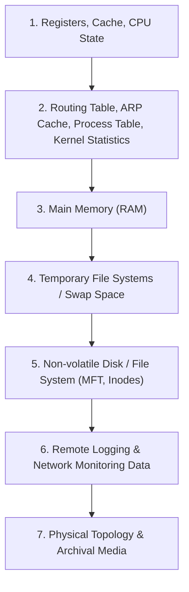

# Digital Forensics & Incident Response Fundamentals

## 1. Context & Objective
Digital Forensics and Incident Response (DFIR) focuses on identifying, containing, and analyzing cyber attacks while methodically gathering digital evidence that maintains evidentiary integrity.

---

## 2. Order of Volatility (RFC 3227)
When capturing evidence from a compromised live host, collect evidence from most volatile to least volatile:



> [!IMPORTANT]
> Always acquire volatile memory before powering down or rebooting a machine. Powering off destroys RAM and active encryption keys.

---

## 3. Evidence Integrity & Chain of Custody
1. **Cryptographic Hashing:** Immediately hash every acquired forensic image using SHA-256 (or MD5 + SHA-256) upon acquisition:
   ```bash
   sha256sum /mnt/evidence/evidence-host01.raw > evidence-host01.raw.sha256
   ```
2. **Write Blocking:** Always use a hardware or software write-blocker when attaching suspect drives for acquisition:
   ```bash
   # Read-only mount in Linux forensic workstation
   mount -o ro,noload /dev/sdb1 /mnt/suspect_drive
   ```
3. **Chain of Custody Documentation:** Record exact date/time, acquisition technician, hardware serial numbers, and evidence storage locker locations.

---

## 4. Key Windows Forensic Artifacts

| Artifact | Location | Value to Investigator |
| :--- | :--- | :--- |
| **Prefetch Files** | `C:\Windows\Prefetch\*.pf` | Proves program execution, execution count, and timestamp of last run. |
| **Shimcache (AppCompatCache)** | `SYSTEM` Registry hive | Proves application presence and path, even if the binary was deleted. |
| **Amcache.hve** | `C:\Windows\appcompat\Programs\Amcache.hve` | Program execution, file SHA-1 hashes, and uninstalled program history. |
| **Master File Table ($MFT)** | Root of NTFS volume | Metadata for all files: timestamps ($STANDARD_INFORMATION, $FILE_NAME), size, allocated clusters. |
| **Security Event Log** | `C:\Windows\System32\winevt\Logs\Security.evtx` | Authentication (4624/4625), process creation (4688), user management (4720). |
| **SRUM** | `C:\Windows\System32\sru\SRUDB.dat` | System Resource Usage Monitor: historical network bytes sent/received and app runtime. |

---

## 5. Timeline Analysis Methodology (Super-Timeline)
1. **Extraction:** Extract MACB (Modified, Accessed, Created, Born) timestamps from file system and artifacts:
   - Tooling: `log2timeline` (Plaso), `analyzeMFT`, `Hayabusa`
2. **Filtering:** Filter out known operating system updates and baseline noise.
3. **Pivoting:** Pivot around the known detection point (Initial Access timestamp $\pm 1$ hour).

---

## 6. Sanitization and Storage Rules in `kbase`
- **Never commit `.raw`, `.dmp`, `.vmdk`, or `.pcap` files.** Store them on an external forensic drive or local NAS.
- Commit only structured investigation notes using [`templates/dfir-investigation.md`](../../../templates/dfir-investigation.md).
- Use redacted indicators and SHA-256 hashes for tracking.
