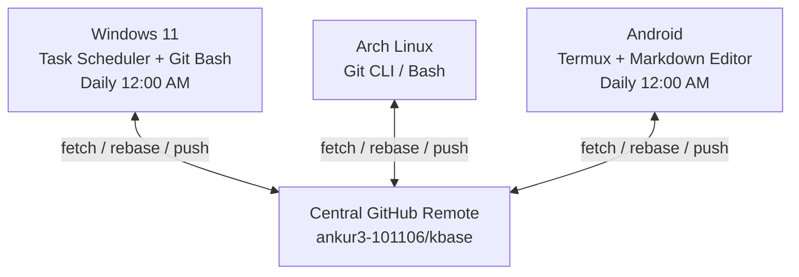

# SOP: Git Synchronization & Conflict Resolution

## 1. System Architecture

`kbase` operates across three computing environments using standard Git push/pull operations and a central GitHub remote:



- **Remote:** `https://github.com/ankur3-101106/kbase.git`
- **Default Branch:** `main`
- **Synchronization Policy:** `git pull --rebase origin main` followed by `git push origin main`.
- **Scheduled Windows Job:** Windows Task Scheduler executing `C:\Users\Ankur\scripts\kbase-sync.sh` using Git Bash (`C:\Program Files\Git\bin\bash.exe`).
- **Scheduled Android Job:** Termux task / cron executing repository synchronization.

---

## 2. Windows Sync Script Mechanics (`kbase-sync.sh`)

The Windows synchronization script performs the following sequence:

1. **Lock Directory Check:** Attempts to create `.git/kbase-sync-lock`. If the lock already exists, the script safely exits to prevent concurrent runs. The lock is automatically removed on exit via a `trap`.
2. **Branch & Remote Validation:** Verifies that the current branch is `main` and the remote origin points to `ankur3-101106/kbase`.
3. **Stage & Commit:** Executes `git add -A`. If changes are detected, commits them with message `Sync Windows notes <timestamp>`.
4. **Merge/Rebase Safety Guard:** Checks if a rebase or merge is already paused or pending:
   ```bash
   [[ -f "$(git rev-parse --git-path rebase-merge)/head-name" ]] ||
   [[ -d "$(git rev-parse --git-path rebase-apply)" ]] ||
   [[ -f "$(git rev-parse --git-path MERGE_HEAD)" ]]
   ```
   If an unfinished merge or rebase is detected, it logs an alert and **stops immediately**, preventing automated scripts from clobbering unmerged files.
5. **Rebase & Push:** Fetches from `origin`, applies local commits on top of remote commits (`git pull --rebase origin main`), and pushes to `origin main`.
6. **Logging:** Logs all output to `C:\Users\Ankur\AppData\Local\KBaseSync\sync.log`.

---

## 3. Resolving Rebase Conflicts

When the same note is edited on two different devices before synchronization occurs, Git may halt during `git pull --rebase` and report conflict markers.

### Step 1: Detect the Conflict
Run `git status` in the repository root:

```bash
git status
```

Output will indicate:
```text
interactive rebase in progress; onto <commit>
You are currently rebasing branch 'main' on '<commit>'.
  (fix conflicts and run "git rebase --continue")
  (use "git rebase --skip" to skip this patch)
  (use "git rebase --abort" to check out the original branch)

Unmerged paths:
  both modified:   knowledge/systems/arch-linux.md
```

### Step 2: Open and Resolve Conflicted Files
Open the conflicted file (`arch-linux.md`) in any text editor. Look for the Git conflict markers:

```text
<<<<<<< HEAD (Current change on remote)
Remote content updated from Android or Linux...
=======
Local content updated on Windows...
>>>>>>> Sync Windows notes 2026-10-12
```

1. Edit the file to combine the notes or choose the correct text.
2. Delete the markers (`<<<<<<<`, `=======`, `>>>>>>>`).
3. Save the file.

### Step 3: Stage and Continue Rebase
Once all conflict markers are cleaned up:

```bash
# Stage the resolved file
git add knowledge/systems/arch-linux.md

# Continue the rebase
git rebase --continue
```

If Git reports another conflicting commit, repeat Steps 2 and 3. When rebase finishes, you will see `Applying: ...` and a clean working tree.

### Step 4: Push the Resolved State
```bash
git push origin main
```

### Emergency Abort
If you are unsure or want to return to your previous pre-rebase state without losing your work:
```bash
git rebase --abort
```

---

## 4. Recovering from Stale Lockfiles

If a synchronization process was abruptly terminated (e.g., machine shutdown, killed terminal), the lock directory `.git/kbase-sync-lock` might remain on disk, causing subsequent sync attempts to print:
`Another sync appears to be running; skipping.`

### Resolution
1. Verify no Git or sync process is running.
2. In Git Bash or PowerShell:
   ```bash
   # Remove stale lock directory
   rmdir "C:\Users\Ankur\kbase\.git\kbase-sync-lock"
   ```
3. Run the sync command manually to verify:
   ```bash
   bash "C:/Users/Ankur/scripts/kbase-sync.sh"
   ```
4. Check the log file for success:
   ```powershell
   Get-Content "C:\Users\Ankur\AppData\Local\KBaseSync\sync.log" -Tail 20
   ```

---

## 5. Android (Termux) Manual Sync Workflow

When using Android with Termux:

### Pulling Notes
Before writing substantial notes on mobile, pull latest updates:
```bash
cd ~/kbase
git pull --rebase origin main
```

### Pushing Notes
After authoring in your mobile Markdown editor:
```bash
cd ~/kbase
git add -A
git commit -m "Sync Android notes $(date '+%Y-%m-%d %H:%M')"
git pull --rebase origin main
git push origin main
```

---

## 6. Best Practices for Zero-Conflict Operation

1. **Leverage `inbox/` with Unique Filenames:** When jotting down quick notes on mobile, use date and topic slugs (`inbox/YYYY-MM-DD-topic.md`). Two new files in `inbox/` will never cause a merge conflict because their filenames are unique.
2. **Sync Before Editing Large Files:** If you plan an extensive edit to an existing knowledge note, pull first on whatever machine you are using.
3. **Keep Commits Focused:** Avoid mass renaming of folders across multiple offline devices simultaneously.
